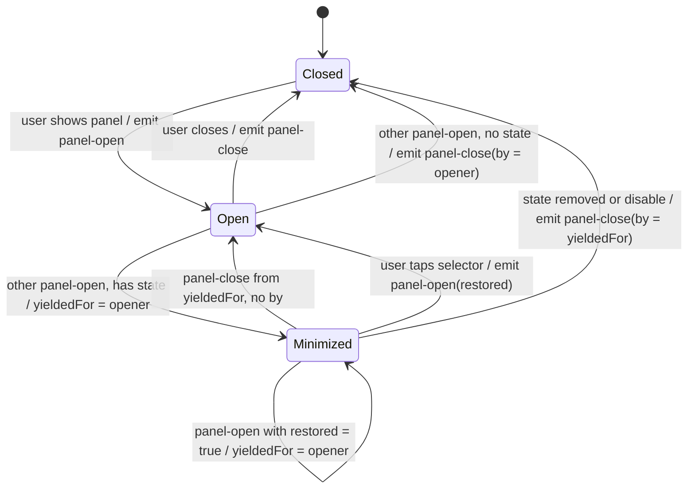

# Plugin panel contract

How CloudTAK web plugins that put controls at the bottom of the map avoid covering each other. This is a TAK-NZ convention between plugins. It needs no host change.

## 1. Purpose and scope

The host `PluginPane` is a single non-wrapping row. When two plugins show a bottom bar at once, the bars compete for width and on a phone neither is usable. This contract makes a plugin that is shown step aside when another plugin shows its panel.

Scope: the `bottom` area only. A host panel API is deferred. Plugins that do not implement the contract are not affected and do not yield.

## 2. Vocabulary

- **Panel**: the controls a plugin shows at the bottom of the map.
- **Selector**: how the user brings the panel up. A menu entry or a map-control button.
- **Open / closed**: the panel is shown / not shown and the plugin holds no hidden work.
- **Minimized**: the controls are hidden but the plugin keeps work that would be lost on close. The selector shows a dot.
- **Yield**: step aside because another plugin opened its panel. A plugin yields by closing or by minimizing.
- **Opener**: the plugin whose `panel-open` made another plugin yield.

## 3. The contract

Two events, dispatched on `window`, synchronously. Event type names:

| Event | `detail` | Meaning |
|---|---|---|
| `cloudtak-plugin:panel-open` | `{ id, area: 'bottom', restored? }` | The plugin showed its panel. `restored: true` only when the user brought a minimized panel back from its selector. |
| `cloudtak-plugin:panel-close` | `{ id, area: 'bottom', by? }` | The plugin closed its panel. `by` is the id of the plugin it closed for. Set only when it yielded, or when a minimized plugin goes away while waiting for someone. |

`id` is a non-empty string, unique per plugin. An event whose `area` is not `'bottom'` is ignored. Unknown fields are ignored, and `restored` counts only when it is the boolean `true`.

## 4. Rules

1. Dispatch `panel-open` right after the user shows your panel. Dispatch `panel-close` right after the user closes it, and on `disable()`.
2. On `panel-open` from another id while your panel is shown, yield. Decide now whether you hold relevant state. Relevant state is work that is lost on close and is not persisted. Settings, persisted values and layers that stay on the map do not count.
   - No state: close, and dispatch `panel-close` with `by` set to the opener.
   - State: minimize (hide the controls, keep the state), remember `yieldedFor = opener`, show the dot.
3. On `panel-close` from `yieldedFor` while minimized: if `by` is set and is not your own id, set `yieldedFor = by` and stay hidden. Otherwise restore and clear `yieldedFor`. This automatic restore does not dispatch `panel-open`.
4. A minimized plugin that sees a plain `panel-open` from another plugin ignores it and keeps waiting for the plugin it yielded to. This keeps the chain order (section 6). It retargets (`yieldedFor = opener`) only when the event has `restored === true`: that opener was brought back from its selector, so it now sits on top.
5. A plugin that closed never reopens by itself.
6. Tapping the selector of a minimized plugin restores it, clears `yieldedFor`, and dispatches `panel-open` with `restored: true`. Plugins that are shown yield in turn.
7. Ignore your own events. Make handlers idempotent.
8. On `disable()`, if the panel is shown or minimized, call `closed()`, then remove the listeners. A minimized plugin that goes away sends `panel-close` with `by = yieldedFor`, so a plugin waiting for it retargets.
9. Never import another plugin. Never read the host `bottomBar` store.
10. A silent re-add of the bar (for example after a basemap style reload) must not bring back a minimized panel.

## 5. State diagram



## 6. Worked examples

Plugin R has state (it minimizes). Plugins W and C have none (they close). Events are written as `id: event`.

**Chain, all with state (A, B, C).** A is shown. B opens: A minimizes, `yieldedFor(A) = B`. C opens: B minimizes, `yieldedFor(B) = C`. A ignores C's plain `panel-open` and keeps waiting for B. C closes: B restores. B closes: A restores. Plugins come back in reverse order, and at most one panel is shown at any step. The same holds for every order in which the plugins go away; the unit tests cover all six.

**Middle closes (R, W, C).** R is shown. W opens: R minimizes, `yieldedFor(R) = W`. C opens: W has no state, so it closes and sends `panel-close { id: W, by: C }`. R sees a close from `yieldedFor` with `by = C` and retargets: `yieldedFor(R) = C`, still hidden. C closes: R restores. Without `by`, R would stay hidden forever or restore on top of C.

**Selector restore.** A is minimized waiting for B, and B is minimized waiting for C. The user taps A's selector. A restores and sends `panel-open { restored: true }`. B sees a restored open from another plugin while minimized and retargets: `yieldedFor(B) = A`. If C has no state and is shown, it closes with `by = A`. B, already waiting for A, restores when A closes.

## 7. The dot

- One colour: `var(--tblr-primary, #1E90FF)`.
- An 8 px circle at the top-right of the selector icon, with a 2 px ring in the surface colour (`var(--cloudtak-surface-bg, #ffffff)`, or the panel background where the selector sits on a panel).
- One meaning: this plugin is still active (layers on the map, or work in progress) and its controls are hidden.
- Not used for anything else. Do not use it for errors, counts or unread state.

The host menu API has no dot. A menu entry gets one by passing a Vue component as `icon` that reads a reactive flag and draws the dot next to the plugin icon. `badge` and `tooltip` are static and are not suitable. Weather's map-control dot already has this meaning.

## 8. Accessibility

- The dot is never the only signal. Mark it `aria-hidden` and put the state in the selector's accessible name and `title`, for example "Rubber Sheet, controls hidden" or "Weather Controls, layers on, controls hidden". For a menu entry the name is built from content, so put visually hidden text before the label ("Controls hidden. ").
- Keep the selector target at least 38 px, or the host menu item size.
- Check the dot and its ring for 3:1 contrast against both themes.
- Forced colours: use `background-color: Highlight` and `forced-color-adjust: none`.
- No animation on the dot.
- Do not move focus on yield, since the opener holds it. Leave focus alone on restore.
- Where the selector can be hidden (a menu entry set to hidden shows no dot), add a notice inside the plugin pane with a button that restores the controls.

## 9. Checklist for a new plugin

1. Copy `lib/panel-coordinator.ts` (section 10) into the plugin. Do not import it from another plugin.
2. Pick a unique `id`.
3. Decide `hasState()`. Persisted values are not state.
4. Call `opened()` where the user shows the panel and `closed()` where the user closes it.
5. Call `restoreFromSelector()` from the selector.
6. Make `isShown()` false while minimized, and make `close`, `minimize` and `restore` not call `opened()` or `closed()`. When normal close paths call `closed()`, guard the yield-close with a flag so it does not also send a plain `panel-close`.
7. Show the dot from `onMinimizedChange`, with a reactive icon or control. Give the selector a title and an accessible name that include the state.
8. Guard silent re-adds of the bar while minimized.
9. On `disable()` call `closed()` if shown or minimized, then `dispose()`.
10. Add the unit tests (section 11) and a README paragraph.
11. Test in a browser at 390x844 and 844x390 with another panel plugin.

## 10. Reference implementation

`SPDX-License-Identifier: MIT-0`. Copy it as is. Both `cloudtak-plugin-rubbersheet` and `cloudtak-plugin-weather` carry byte-identical copies of this file.

```ts
// SPDX-License-Identifier: MIT-0
// Copy into your plugin. Do not import it from another plugin.
//
// Plugin panel contract for the bottom of the map (area 'bottom'). Two events on the target (default: window):
//   cloudtak-plugin:panel-open   { id, area, restored? }  a plugin has shown its panel; `restored` is true only
//                                                   when the user brought a minimized panel back from its selector
//   cloudtak-plugin:panel-close  { id, area, by? }  a plugin has closed its panel; `by` is the id of the plugin
//                                                   it closed for (set only when it yielded, or when a minimized
//                                                   plugin goes away while waiting for someone)
// A plugin that shows a panel while another plugin's panel is shown makes that plugin yield: it closes (no state
// to lose) or minimizes (hides the controls, keeps the state) and restores when the opener closes.
// A plugin that is already minimized ignores a plain panel-open from another plugin (it keeps waiting for the one it
// yielded to, so a chain A, B, C restores in reverse order). It retargets its wait to the opener only when the
// panel-open has `restored === true` (the opener was brought back from its selector, so it now sits on top).
export type PanelArea = 'bottom';
export interface PanelEventDetail { id: string; area: PanelArea; by?: string; restored?: boolean }
export const PANEL_OPEN = 'cloudtak-plugin:panel-open';
export const PANEL_CLOSE = 'cloudtak-plugin:panel-close';

export interface PanelCoordinatorOptions {
    id: string;
    area?: PanelArea;
    target?: EventTarget;
    /** Controls visible right now. Must be false while minimized. */
    isShown(): boolean;
    /** Asked at yield time: would closing lose work that is not persisted? */
    hasState(): boolean;
    /** Hide the controls and drop UI state. Must NOT call opened() or closed(). */
    close(): void;
    /** Hide the controls, keep the state. Must NOT call opened() or closed(). */
    minimize(): void;
    /** Show the controls again. Must NOT call opened() or closed(). */
    restore(): void;
    /** Drives the dot on the selector. */
    onMinimizedChange?(minimized: boolean): void;
}

export interface PanelCoordinator {
    readonly minimized: boolean;
    /** The user showed the panel. */
    opened(): void;
    /** The user closed the panel, or the plugin is shutting down while it is shown or minimized. */
    closed(): void;
    /** The user tapped the selector of a minimized plugin. Counts as opening. */
    restoreFromSelector(): void;
    dispose(): void;
}

function read(e: Event, area: PanelArea): PanelEventDetail | null {
    const d = (e as CustomEvent).detail as Partial<PanelEventDetail> | null | undefined;
    if (!d || typeof d.id !== 'string' || d.id === '' || d.area !== area) return null;
    return {
        id: d.id,
        area,
        by: typeof d.by === 'string' && d.by !== '' ? d.by : undefined,
        // Strictly the boolean true; anything else is a plain open.
        restored: d.restored === true,
    };
}

export function createPanelCoordinator(o: PanelCoordinatorOptions): PanelCoordinator {
    const area = o.area ?? 'bottom';
    const target = o.target ?? window;
    let yieldedFor: string | null = null;
    let minimized = false;
    const setMin = (v: boolean): void => {
        if (minimized !== v) {
            minimized = v;
            o.onMinimizedChange?.(v);
        }
    };
    const emit = (type: string, extra: { by?: string; restored?: true } = {}): void => {
        target.dispatchEvent(new CustomEvent<PanelEventDetail>(type, {
            detail: { id: o.id, area, ...(extra.by ? { by: extra.by } : {}), ...(extra.restored ? { restored: true } : {}) },
        }));
    };
    const onOpen = (e: Event): void => {
        const d = read(e, area);
        if (!d || d.id === o.id) return;
        if (minimized) {
            // A plain open keeps the current wait. A restored open means that plugin is now on top: wait for it.
            if (d.restored) yieldedFor = d.id;
            return;
        }
        if (!o.isShown()) return;
        if (o.hasState()) {
            o.minimize();
            yieldedFor = d.id;
            setMin(true);
        } else {
            o.close();
            emit(PANEL_CLOSE, { by: d.id });
        }
    };
    const onClose = (e: Event): void => {
        const d = read(e, area);
        if (!d || d.id === o.id || yieldedFor === null || d.id !== yieldedFor) return;
        if (d.by && d.by !== o.id) {
            yieldedFor = d.by;
            return;
        }
        yieldedFor = null;
        setMin(false);
        o.restore();
    };
    target.addEventListener(PANEL_OPEN, onOpen);
    target.addEventListener(PANEL_CLOSE, onClose);
    return {
        get minimized() { return minimized; },
        opened() {
            yieldedFor = null;
            setMin(false);
            emit(PANEL_OPEN);
        },
        closed() {
            const by = yieldedFor ?? undefined;
            yieldedFor = null;
            setMin(false);
            emit(PANEL_CLOSE, { by });
        },
        restoreFromSelector() {
            if (!minimized) return;
            yieldedFor = null;
            setMin(false);
            o.restore();
            emit(PANEL_OPEN, { restored: true });
        },
        dispose() {
            target.removeEventListener(PANEL_OPEN, onOpen);
            target.removeEventListener(PANEL_CLOSE, onClose);
            yieldedFor = null;
            setMin(false);
        },
    };
}
```

## 11. Test recipe

Use a fake `EventTarget` passed as `target`. Cases:

- A foreign open while shown with state calls `minimize` once and sets the minimized flag. Without state it calls `close` once and emits `panel-close` with `by`.
- A foreign open while not shown does nothing. Own events are ignored.
- Malformed detail (missing id, wrong area, non-object) is ignored.
- A close from `yieldedFor` restores and does not emit `panel-open`. A close from another id is ignored.
- A close with `by` retargets and does not restore. A later close from `by` restores.
- `restoreFromSelector()` restores, emits `panel-open` with `restored: true` once, and does nothing when not minimized. `opened()` does not set `restored`.
- A plain foreign open while minimized neither minimizes twice nor retargets. A foreign open with `restored: true` retargets. A `restored` value that is not the boolean `true` is a plain open.
- `closed()` while minimized emits `by = yieldedFor`.
- `dispose()` removes both listeners.
- Three plugins (A, B, C) on one target restore in reverse order for all six orders in which they go away, with at most one shown at any step. The middle-closes case restores the first plugin only after the top plugin closes.

Browser scenarios: two plugins at 390x844 and 844x390; open each in turn, check one bar at a time, check the dot and the accessible name, restore from the selector, and change the basemap while minimized.

## 12. Known limits

- The host `PluginPane` is unchanged. This is a convention, not enforcement.
- A menu entry set to `partial` or `hidden` shows no rail dot. Use the in-pane notice.
- Plugins that do not implement the contract do not yield.
- If the opener crashes, the waiting plugin stays hidden until its selector is tapped. The selector is the escape hatch.
- If the top plugin C has state and the user restores A from its selector, C minimizes while waiting for A, and B also waits for A. When A closes, B and C both restore.
- On phones the menu is a full-screen route, so a menu-entry dot is seen only while the menu is open. A map-control selector is always visible.
